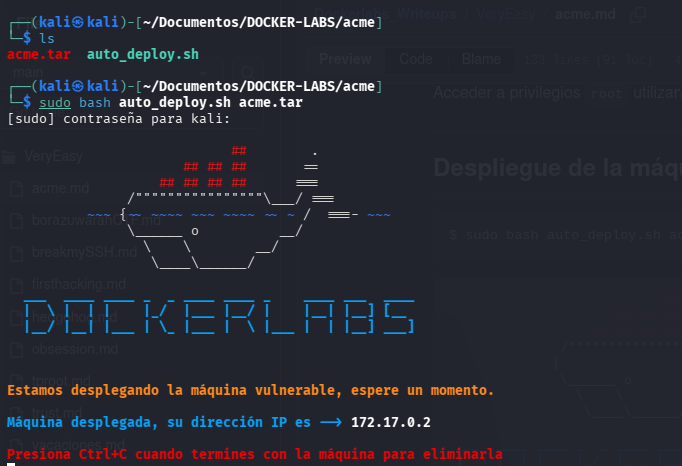
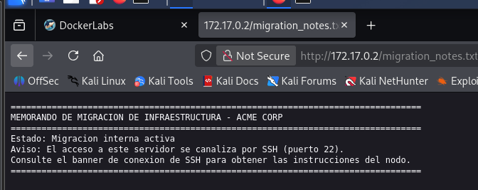
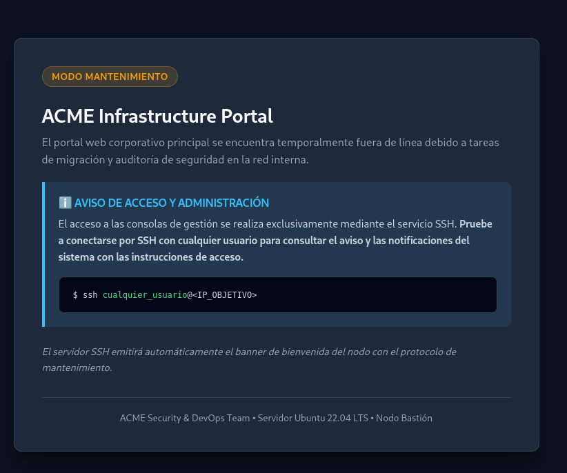
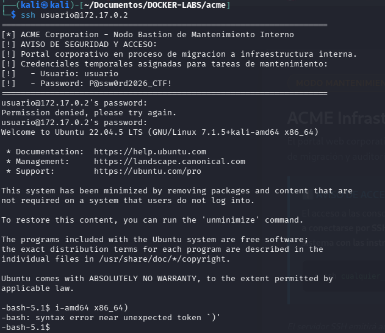

# Acme - DockerLabs

## Creada por: mikisbd

##Información: 
- Maquina con acceso fácil al ssh donde después deberás explorar los servicios web interno e intentar explotarlo

## Información general

- Plataforma: DockerLabs

- Dificultad: Muy fácil
- Sistema operativo: Linux
- Fecha: 09/11/2026
- Estado: En progreso

## Verificación de conectividad

```
┌──(kali㉿kali)-[~/Documentos/DOCKER-LABS/acme]
└─$ ping 172.17.0.2
PING 172.17.0.2 (172.17.0.2) 56(84) bytes of data.
64 bytes from 172.17.0.2: icmp_seq=1 ttl=64 time=0.073 ms
64 bytes from 172.17.0.2: icmp_seq=2 ttl=64 time=0.051 ms
64 bytes from 172.17.0.2: icmp_seq=3 ttl=64 time=0.050 ms
64 bytes from 172.17.0.2: icmp_seq=4 ttl=64 time=0.041 ms
64 bytes from 172.17.0.2: icmp_seq=5 ttl=64 time=0.041 ms
64 bytes from 172.17.0.2: icmp_seq=6 ttl=64 time=0.047 ms
64 bytes from 172.17.0.2: icmp_seq=7 ttl=64 time=0.050 ms
64 bytes from 172.17.0.2: icmp_seq=8 ttl=64 time=0.045 ms
64 bytes from 172.17.0.2: icmp_seq=9 ttl=64 time=0.045 ms
^C
--- 172.17.0.2 ping statistics ---
9 packets transmitted, 9 received, 0% packet loss, time 8176ms
rtt min/avg/max/mdev = 0.041/0.049/0.073/0.009 ms
```

## 1. Reconocimiento

- Comando usado
```
┌──(kali㉿kali)-[~/Documentos/DOCKER-LABS/acme]
└─$ nmap -p- --open -sV -sC -n 172.17.0.2  
```
- Resultado
```
PORT   STATE SERVICE VERSION
22/tcp open  ssh     OpenSSH 8.9p1 Ubuntu 3ubuntu0.16 (Ubuntu Linux; protocol 2.0)
| ssh-hostkey: 
|   256 ae:8a:0a:ff:6e:ce:89:a3:31:d7:da:44:85:0d:f4:de (ECDSA)
|_  256 3f:e8:fa:07:33:e8:43:0a:22:1d:6d:15:a6:53:04:7e (ED25519)
80/tcp open  http    Apache httpd 2.4.52 ((Ubuntu))
| http-robots.txt: 1 disallowed entry 
|_/migration_notes.txt
|_http-server-header: Apache/2.4.52 (Ubuntu)
|_http-title: ACME Corporation - Portal en Mantenimiento
MAC Address: 3E:D2:54:47:26:C2 (Unknown)
Service Info: OS: Linux; CPE: cpe:/o:linux:linux_kernel
```
# 2. Enumeración
### 2.1 Escaneo de puertos y servicios con Nmap

Se realizó un escaneo de todos los puertos TCP para identificar aquellos que se encontraban abiertos, así como los servicios y versiones que estaban ejecutándose.

**Comando utilizado:**

```bash
nmap -p- --open -sV -sC -n 172.17.0.2
```

**Resultados obtenidos:**

```text
PORT   STATE SERVICE VERSION
22/tcp open  ssh     OpenSSH 8.9p1 Ubuntu 3ubuntu0.16
80/tcp open  http    Apache httpd 2.4.52 (Ubuntu)
```

**Análisis de resultados:**

Se identificaron dos puertos abiertos:

- **Puerto 22 (SSH):** ejecuta OpenSSH 8.9p1 sobre Ubuntu. Permite conexiones remotas mediante SSH.
- **Puerto 80 (HTTP):** ejecuta Apache 2.4.52 sobre Ubuntu. Aloja un portal web corporativo en mantenimiento.

Además, Nmap identificó una entrada en el archivo robots.txt:

```text
/migration_notes.txt
```


Este recurso será considerado para la posterior enumeración web.

## 3. Análisis de vulnerabilidades
### 3.1 Identificación de tecnologías web con WhatWeb

Se utilizó WhatWeb para identificar las tecnologías y características del servidor web.

**Comando utilizado:**

```bash
whatweb 172.17.0.2
```

**Resultado obtenido:**

```text
http://172.17.0.2 [200 OK]
Apache[2.4.52]
HTML5
HTTPServer[Ubuntu Linux][Apache/2.4.52 (Ubuntu)]
Title[ACME Corporation - Portal en Mantenimiento]
UncommonHeaders[x-notice]
```

**Análisis:**

Se confirmó que el servidor web utiliza Apache 2.4.52 sobre Ubuntu. La página respondió con el código HTTP 200 OK y mostró un título relacionado con el portal de ACME Corporation.

También se identificó una cabecera HTTP poco común denominada `X-Notice`, que puede ser revisada posteriormente.

### 3.2 Inspección del contenido web con Curl

Se utilizó Curl para consultar el contenido HTML de la página principal.

**Comando utilizado:**

```bash
curl http://172.17.0.2/
```

**Hallazgos importantes:**

Al revisar el código HTML se encontró un mensaje de mantenimiento que indicaba lo siguiente:

- El portal corporativo se encontraba fuera de línea por tareas de migración.
- Las consolas de gestión eran accesibles exclusivamente mediante SSH.
- Se recomendaba conectarse por SSH con cualquier usuario para consultar las notificaciones e instrucciones de acceso.



**Análisis:**

El contenido de la página proporcionó una pista importante para continuar con la enumeración del servicio SSH.

## 4. Explotación
### 4.1 Obtención del banner de bienvenida

Se intentó establecer una conexión SSH utilizando el usuario `root`.

**Comando utilizado:**

```bash
ssh root@172.17.0.2
```

Aunque el acceso como root fue rechazado, el servidor mostró un banner de bienvenida con información relevante.

**Información encontrada:**

```text
ACME Corporation - Nodo Bastion de Mantenimiento Interno

Credenciales temporales asignadas para tareas de mantenimiento:

Usuario: usuario
Password: [REDACTADO]
```

**Análisis:**

El banner SSH reveló la existencia de un usuario temporal destinado a tareas de mantenimiento. Esta información permitió identificar un posible usuario válido para realizar el acceso inicial.
## 5. Escalada de privilegios
### 5.1 Conexión mediante SSH

Se utilizó el usuario identificado en el banner para establecer una conexión remota.

**Comando utilizado:**

```bash
ssh usuario@172.17.0.2
```



**Resultado:**

Se consiguió establecer una sesión SSH y acceder a una terminal del sistema Ubuntu 22.04.5 LTS.


**Análisis:**

Se obtuvo acceso inicial al sistema con una cuenta de usuario sin privilegios de administrador. Este acceso permitirá continuar con la enumeración interna y buscar posibles vías de escalada de privilegios.

### 5.2 Verificación de permisos sudo

Después de obtener acceso inicial, comprobé si el usuario tenía permisos para ejecutar comandos con privilegios elevados.

**Comando utilizado:**
```
sudo -l
```
**Explicación:**
- sudo: permite ejecutar comandos con privilegios de otro usuario, normalmente root.
- -l: muestra los permisos y comandos que el usuario tiene autorizados mediante sudo.

**Resultado obtenido:**
  ```
  Sorry, user usuario may not run sudo
  ```

Análisis: La cuenta usuario no tenía permisos para ejecutar comandos mediante sudo. Por lo tanto, fue necesario continuar enumerando el sistema para identificar otras posibles vías de escalada.

### 5.3 Búsqueda de archivos con permisos SUID

**Comando utilizado:**
```
find / -perm -4000 2>/dev/null
```

**Explicación de cada parte:**

- find  --> Busca archivos y directorios.
- /     --> Indica que la búsqueda comienza desde la raíz del sistema.
- -perm --> Permite buscar archivos según sus permisos.
- -4000 --> Busca archivos que tengan activado el bit SUID.
- 2>    --> Redirige los mensajes de error.
- /dev/null --> Descarta los mensajes de error para mostrar una salida más limpia.

**Resultado obtenido:**


Entre los archivos encontrados se identificó:

## 6. Evidencias

## 7. Conocimientos adquiridos

## 8. Conclusión
